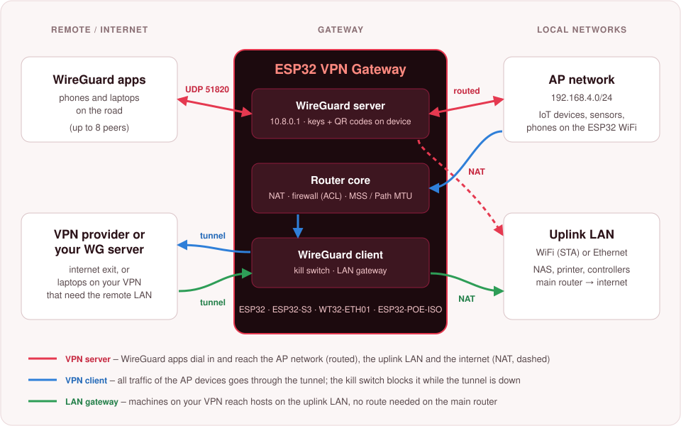

# ESP32 VPN Gateway

The ESP32 VPN Gateway is a firmware that turns a 2 $ ESP32 into a small **WireGuard gateway**. It is built on the [ESP32 NAT Router](https://github.com/martin-ger/esp32_nat_router) and keeps all of its features, but adds VPN functions in every direction:

- **VPN client (uplink)**: all traffic of the devices on the ESP32's WiFi access point goes through a WireGuard tunnel to a VPN provider or your own server.
- **VPN server (inbound)**: phones and laptops connect *in* to the ESP32 with any WireGuard app and reach the AP network and the internet behind it.
- **LAN gateway**: machines on the VPN reach hosts on the network the ESP32 is connected to, without touching that network's main router.



Use cases:

- A pocket VPN router: every device on the ESP32's WiFi is tunnelled, with a kill switch
- Reach your home or lab network from anywhere: run the WireGuard server on the ESP32, no change to the main router except one UDP port forward
- Remote access to a network you don't control (a holiday flat, a customer site, a lab): the ESP32 dials out to your WireGuard server, and your VPN machines reach the hosts on that network through it
- A small, separate VPN network for IoT devices

## What's different from the ESP32 NAT Router

| Area | ESP32 NAT Router | ESP32 VPN Gateway |
|------|------------------|-------------------|
| WireGuard client | ✓ (AP clients only) | ✓, plus the opt-in **[LAN gateway](#lan-gateway)** |
| WireGuard server | – | ✓ up to 8 clients, keys, configs and QR codes generated on the device (ESP32, ESP32-S3, WT32-ETH01, ESP32-POE-ISO) |
| Firewall | ACL lists `to_esp`, `from_esp`, `to_ap`, `from_ap` | adds `to_wg` / `from_wg` for the server tunnel |
| Packet capture | AP and uplink | also the decrypted server tunnel traffic |
| MQTT | HA telemetry client publishing to an external broker | built-in **local MQTT broker** for LAN devices (see [MQTT Broker](#mqtt-broker)) |
| Web UI | blue/purple theme | red theme, new **🔐 VPN Server** page, VPN server status on the index page |
| Name | "ESP32 NAT Router" | "ESP32 VPN Gateway" on the index page and in the serial and remote console banners |

Everything else (routing, DHCP reservations, port forwarding, WPA2-Enterprise, OLED and LED status, remote console, MCP bridge, OTA, …) works exactly as in the NAT router and is documented in the [ESP32 NAT Router wiki](https://github.com/martin-ger/esp32_nat_router/wiki).

On first boot the ESP32 offers the open WiFi network **ESP32_VPN_Gateway**. Connect to it and open **http://esp32-vpn-gateway.local** (or http://192.168.4.1) to configure the uplink. Where the NAT router wiki mentions "ESP32_NAT_Router" or "esp32-nat-router", use these names instead.

## WireGuard Server

On the **ESP32**, **ESP32-S3**, **WT32-ETH01** and **ESP32-POE-ISO** builds, the ESP32 can be the WireGuard server for up to **8 clients**:

- **Keys on the device**: the router can create a client's key pair and show a ready-to-use config file and QR code. The client's private key is shown once and never stored.
- **Optional preshared key** per client
- **Full or split tunnel** configs
- **AP network access**: VPN clients and AP clients reach each other directly (routed, no NAT)
- **Client to client**: VPN clients reach each other's tunnel addresses
- **Internet** through the router's uplink, masqueraded behind the uplink address
- **Configurable tunnel MTU** (1280–1420), written into the client configs, with MSS clamping on the tunnel
- **Path MTU**: hosts on the uplink side (LAN or internet) that send a reply with DF set larger than the tunnel MTU get ICMP Fragmentation Needed, so they lower their packet size
- **Uplink LAN access**: VPN clients reach hosts on the router's uplink network (masqueraded, always on; restrict it with `to_wg` rules)
- **Replay protection across reboots**
- **Status** per client: endpoint, last handshake, traffic, rejected handshakes

### Quick start

```
wg_server enable
wg_server host myhome.example.org      # address the clients dial (optional)
restart
wg_server peer add phone               # prints the client config once
```

Then forward UDP port 51820 on your internet router to the ESP32. The same can be done on the **🔐 VPN Server** page (`/wgserver`), which also shows the client config as a QR code for the WireGuard app.

### `wg_server` command

```
wg_server status                      - Show settings and peers
wg_server enable|disable              - Turn the server on/off (restart to apply)
wg_server port <port>                 - UDP listen port (restart to apply)
wg_server mtu <1280-1420>             - Tunnel MTU, MSS clamp = MTU-40 (restart; re-export client configs)
wg_server subnet <ip> [netmask]       - Server tunnel address, default 10.8.0.1/24 (restart to apply)
wg_server host <name|ip>              - Public address written into client configs (- clears it)
wg_server genkey                      - New server key (restart; re-export all clients)
wg_server peer add <name> [-k <pubkey>] [-i <ip>] [-s] [-p | -P <psk>]
                                      - Add a client; without -k a key pair is generated
                                        -s: split tunnel config, -p: generate a preshared key,
                                        -P: use this preshared key
wg_server peer del <name>             - Remove a client
wg_server peer conf <name> [-s]       - Print the config again, without the private key
```

### Firewall for the tunnel

Two new ACL lists filter the server tunnel: `to_wg` (VPN clients → router) and `from_wg` (router → VPN clients). They use the same syntax as the other lists:

```
# VPN clients may only use the web servers in the AP network
acl to_wg TCP any * 192.168.4.0/24 80 allow
acl to_wg IP any 192.168.4.0/24 deny

# Isolate the VPN clients from each other
acl to_wg IP any 10.8.0.1 allow
acl to_wg IP any 10.8.0.0/24 deny
```

### Limits

- **Limited performance**: the ESP32 encrypts all WireGuard traffic in software, so throughput is a small fraction of what a PC or a dedicated router achieves, and it shares the CPU with NAT routing. The gateway is meant mainly for reaching IoT networks with low traffic demands (sensors, controllers, web UIs, SSH), not for streaming, large downloads or many simultaneous users.
- The server and the WireGuard client are **mutually exclusive**: the server doesn't start while the client is enabled.
- IPv4 only. The router must be reachable from the internet on the UDP port; an uplink behind carrier-grade NAT can't take incoming connections.

Details: [WireGuard Server](https://github.com/martin-ger/esp32_nat_router/wiki/WireGuard-Server) in the wiki.

## LAN Gateway

By default the WireGuard client tunnel only serves the ESP32's own AP clients. With the **LAN gateway** switched on, machines on the VPN can also reach hosts on the ESP32's **uplink network**: the WiFi network it joined as a station, or its wired LAN on the Ethernet builds.

```
  laptop on the VPN ──► your WG server ──► tunnel ──► ESP32 ──NAT──► 192.168.178.20 (NAS)
                                                       uplink 192.168.178.101
```

How it works:

- **NAT**: packets from the tunnel to the uplink subnet are masqueraded to the ESP32's uplink address. LAN hosts answer the ESP32, so the network's main router needs **no static route** back into the VPN.
- **MSS clamping**: TCP SYNs through the tunnel are clamped to tunnel MTU − 40 in both directions, because LAN hosts assume 1500.
- **Path MTU**: if a LAN host sends a reply with DF set that is larger than the tunnel MTU, the ESP32 answers with ICMP Fragmentation Needed, so the host lowers its packet size.

Only the uplink subnet itself is reachable; the ESP32 is not an internet exit for VPN peers. AP clients keep working as before. Connections are started from the VPN side.

### Setup

1. Switch it on and restart:
   ```
   set_vpn -L 1
   restart
   ```
   or set **LAN Gateway** to **On** on the `/vpn` page.
2. On your WireGuard server, route the uplink subnet to the ESP32 by adding it to the ESP32 peer's `AllowedIPs`:
   ```ini
   [Peer]
   # ESP32 VPN Gateway
   PublicKey = <ESP32 public key>
   AllowedIPs = 10.0.0.2/32, 192.168.4.0/24, 192.168.178.0/24
   ```
3. On the remote machines, route the same subnet into their tunnel (add it to their `AllowedIPs`). It must not overlap with the networks they are on.

`show vpn` and the `/vpn` page show `LAN Gateway: on (active)` while it is applied to a connected tunnel.

### Notes

- **Security**: every machine that can send through your VPN server to this peer reaches the whole uplink network. Only use it with a VPN you control, and keep it off otherwise (default).
- The VPN server has to route a subnet to the ESP32, so use a Linux (or similar) WireGuard server. The WireGuard server built into this firmware routes only each client's own tunnel address.
- Needs NAT on the AP to be on (the default).
- The NAT table (512 entries) is shared with the AP clients. With a WiFi uplink, traffic enters and leaves on the same radio, so expect a fraction of the normal VPN throughput.
- Path MTU is reported for replies from the 16 most recently used remote endpoints (address, protocol, port); TCP is covered by the MSS clamp in any case.

Details: [LAN Gateway](https://github.com/martin-ger/esp32_nat_router/wiki/WireGuard-VPN#lan-gateway) in the wiki.

## WireGuard Client

The client works as in the NAT router: route all traffic or split tunnel, kill switch, custom DNS for AP clients, configurable MTU with automatic MSS clamping and Path MTU, and import of a standard `.conf` file on the `/vpn` page. New and changed options of `set_vpn`:

```
set_vpn ... [-L <0|1>]     LAN gateway: VPN peer reaches the uplink LAN via NAT (default 0)
set_vpn -k ""              Remove the preshared key
```

Details: [WireGuard VPN](https://github.com/martin-ger/esp32_nat_router/wiki/WireGuard-VPN) in the wiki.

## MQTT Broker

The gateway runs its own **local MQTT broker** (an [Espressif port of Mosquitto](https://components.espressif.com/components/espressif/mosquitto)), so devices can talk MQTT without an external broker — e.g. Home Assistant, Tasmota or ESPHome devices:

- **Pick the interfaces**: the broker serves any combination of the **AP** (default, LAN only: `mqtt://192.168.4.1:1883`, not reachable from the uplink or the internet), **STA** (the uplink network) and **VPN** (the tunnel, for clients behind the WireGuard VPN) interfaces. Connections arriving on unselected interfaces are rejected. While none of the selected interfaces has an IP, the broker waits.
- **Optional authentication**: without a configured user the broker is open; with a user, every connection must present that user and password.
- **No TLS** transport in this port.

```
mqtt enable
mqtt bind ap,vpn             # comma-separated list of ap, sta, vpn — or: all
mqtt user ha <password>      # or: mqtt user off  (open broker)
mqtt port 1883
mqtt status
```

The **MQTT Broker** section on the Configuration page does the same. The broker is off by default; only while it is running does it use RAM (an 8 kB task stack plus ~4 kB heap per connected client).

## Security

With the WireGuard server on, the ESP32 has a UDP port open to the internet. The firmware is built with that in mind, but it is a small, low-cost device: configure it carefully and keep the exposed surface to that one port.

### Security features of the build

- **Stack canaries**: all builds are compiled with GCC stack protection (`CONFIG_COMPILER_STACK_CHECK_MODE_NORM`, set in `sdkconfig.defaults.esp32` and `sdkconfig.defaults.esp32s3`). Functions with local buffers get a canary value before their return address; a stack buffer overflow overwrites it, and the ESP32 panics and reboots instead of running injected code. This turns the most common memory-corruption bug in packet and config parsing into a denial of service rather than a takeover.
- **Task stack checks**: FreeRTOS checks a canary at the end of each task stack on every context switch and halts on overflow.
- **Memory protection** (ESP32-S3): data RAM is not executable and instruction RAM is not writable (`CONFIG_ESP_SYSTEM_MEMPROT_FEATURE`), which blocks injected code from running.
- **WireGuard**: the server answers only peers that know their key pair; packets from anyone else are silently dropped, so a port scan shows nothing. Optional preshared keys per peer add a second, symmetric secret. Replay protection survives reboots.
- **Keys**: client private keys generated on the device are shown once and never stored or logged. The server's peer table with the preshared keys, the WiFi passwords and the WireGuard private keys are left out of plain-text config exports; encrypted exports (XChaCha20-Poly1305, passphrase via PBKDF2) include them.
- **Passwords** for the web UI and remote console are stored as salted SHA-256 hashes.

Not included: the web UI and remote console use plain HTTP and TCP (no TLS), and secure boot and flash encryption are off. WiFi passwords and WireGuard keys are stored unencrypted in flash, so physical access to the device means access to them.

### Secure configuration

1. **Set a password** for the web UI and remote console:
   ```
   set_router_password <strong-password>
   ```
2. **Keep management off the uplink.** Allow the web UI only from the AP network, or only through the VPN (`vpn` covers both the client tunnel and the server tunnel address 10.8.0.1). Switch off the remote console if you don't use it:
   ```
   web_ui bind vpn                  # or: web_ui bind ap
   remote_console disable           # or: remote_console bind vpn
   ```
3. **Forward only the WireGuard port** (UDP 51820) on your internet router. Never forward port 80 or 2323 to the ESP32.
4. **One key pair per device**, with a preshared key (`wg_server peer add <name> -p`). Remove lost or retired devices at once (`wg_server peer del <name>`), and use split-tunnel configs (`-s`) for clients that don't need the internet through the ESP32.
5. **Restrict what VPN clients reach.** Access to the uplink LAN is always on; limit it, and the AP network, with `to_wg` rules (see [Firewall for the tunnel](#firewall-for-the-tunnel)).
6. **Leave the LAN gateway off** unless you need it, and use it only with a VPN server you control.
7. **Keep the kill switch on** (default) when the AP devices must never leave the tunnel.
8. **Encrypt config backups**: enter a passphrase before exporting.
9. **Physical security**: if others can get hold of the device, build with flash encryption and secure boot, and run `esptool.py erase_flash` before passing it on (re-flashing alone keeps the stored keys).

More in [Security](https://github.com/martin-ger/esp32_nat_router/wiki/Security) in the NAT router wiki.

## Other Changes

- **Packet capture**: in promiscuous mode, the capture also records the decrypted traffic of VPN server clients. In ACL monitor mode it records the packets of `to_wg` / `from_wg` rules with the monitor flag. See [Packet Capture](https://github.com/martin-ger/esp32_nat_router/wiki/Packet-Capture).
- **MQTT / Home Assistant**: new entities **VPN Status** (binary sensor), **VPN Clients** (WireGuard server builds) and **CPU Temperature** (chips with a temperature sensor). See [MQTT Home Assistant](https://github.com/martin-ger/esp32_nat_router/wiki/MQTT-Home-Assistant).
- **Web UI**: red theme and red icon, the **🔐 VPN Server** page, a VPN server status row on the index page, and the **LAN Gateway** field on the VPN page.
- **NVS keys**: `vpn_lan_gw` for the LAN gateway, and the `wgs_*` keys of the server. The server's peer table holds the preshared keys and is left out of plain-text config exports. See [NVS Storage](https://github.com/martin-ger/esp32_nat_router/wiki/NVS-Storage).

## Supported Hardware

| Build | Chip | Uplink | WG client + LAN gateway | WG server |
|-------|------|--------|:-----------------------:|:---------:|
| `esp32` | ESP32 | WiFi | ✓ | ✓ |
| `esp32s3` | ESP32-S3 | WiFi | ✓ | ✓ |
| `wt32_eth01` | ESP32 | Ethernet (LAN8720) | ✓ | ✓ |
| `esp32_poe_iso` | ESP32 | Ethernet | ✓ | ✓ |

All builds use dual-core chips (**ESP32-S3** or **ESP32**), because WireGuard encryption costs CPU time. The single-core ESP32-C3, C5 and C6 are not supported.

## Everything Else

All other features come unchanged from the ESP32 NAT Router. In short:

- NAT routing between the AP and the WiFi or Ethernet uplink, 5–15 Mbit/s
- DHCP reservations, port forwarding, TTL override, custom DNS
- Firewall (ACL) with monitoring
- WPA2-Enterprise uplink (PEAP, TTLS, TLS)
- Web UI with password protection, serial console, remote console (TCP)
- LED and LED strip status, OLED display
- syslog
- MCP bridge for AI assistants
- OTA updates from the web UI, configuration backup and restore

See the [ESP32 NAT Router wiki](https://github.com/martin-ger/esp32_nat_router/wiki) for all of these, in particular:

| Page | Description |
|------|-------------|
| [Web Interface](https://github.com/martin-ger/esp32_nat_router/wiki/Web-Interface) | Web UI pages, security, backup/restore |
| [WiFi and Network](https://github.com/martin-ger/esp32_nat_router/wiki/WiFi-and-Network) | DHCP reservations, port forwarding, WPA2-Enterprise, TTL, DNS |
| [Firewall](https://github.com/martin-ger/esp32_nat_router/wiki/Firewall) | ACL packet filtering rules |
| [Security](https://github.com/martin-ger/esp32_nat_router/wiki/Security) | Hardening guide |
| [CLI Reference](https://github.com/martin-ger/esp32_nat_router/wiki/CLI-Reference) | Full command listing |
| [Hardware](https://github.com/martin-ger/esp32_nat_router/wiki/Hardware) | LED status, OLED display, antenna switch, factory reset |
| [Installation](https://github.com/martin-ger/esp32_nat_router/wiki/Installation) | Flashing pre-built binaries |
| [Building](https://github.com/martin-ger/esp32_nat_router/wiki/Building) | Compiling from source |

## Building and Flashing

ESP-IDF 5.5 is required. Build one variant, e.g. the ESP32-S3:

```bash
idf.py -B build_esp32s3 -D SDKCONFIG=sdkconfig.esp32s3 \
  -D SDKCONFIG_DEFAULTS="sdkconfig.defaults;sdkconfig.defaults.esp32s3" build flash monitor
```

`./build_all_targets.sh` builds all variants and copies the binaries to the `firmware_*` directories. Flashing pre-built binaries works as described on the [Installation](https://github.com/martin-ger/esp32_nat_router/wiki/Installation) page; the binaries in this branch's `firmware_*` directories are the VPN Gateway builds.

## Licence

The WireGuard implementation ([esp_wireguard](https://github.com/martin-ger/esp_wireguard_idf_5.5.x)) has the following licence:
```
Copyright (c) 2021 Kenta Ida (fuga@fugafuga.org)

The original license is below:
Copyright (c) 2021 Daniel Hope (www.floorsense.nz)
All rights reserved.

Redistribution and use in source and binary forms, with or without modification,
are permitted provided that the following conditions are met:
* Redistributions of source code must retain the above copyright notice, this
  list of conditions and the following disclaimer.
* Redistributions in binary form must reproduce the above copyright notice, this
  list of conditions and the following disclaimer in the documentation and/or
  other materials provided with the distribution.
* Neither the name of "Floorsense Ltd", "Agile Workspace Ltd" nor the names of
  its contributors may be used to endorse or promote products derived from this
  software without specific prior written permission.

THIS SOFTWARE IS PROVIDED BY THE COPYRIGHT HOLDERS AND CONTRIBUTORS "AS IS" AND
ANY EXPRESS OR IMPLIED WARRANTIES, INCLUDING, BUT NOT LIMITED TO, THE IMPLIED
WARRANTIES OF MERCHANTABILITY AND FITNESS FOR A PARTICULAR PURPOSE ARE
DISCLAIMED. IN NO EVENT SHALL THE COPYRIGHT OWNER OR CONTRIBUTORS BE LIABLE FOR
ANY DIRECT, INDIRECT, INCIDENTAL, SPECIAL, EXEMPLARY, OR CONSEQUENTIAL DAMAGES
(INCLUDING, BUT NOT LIMITED TO, PROCUREMENT OF SUBSTITUTE GOODS OR SERVICES;
LOSS OF USE, DATA, OR PROFITS; OR BUSINESS INTERRUPTION) HOWEVER CAUSED AND ON
ANY THEORY OF LIABILITY, WHETHER IN CONTRACT, STRICT LIABILITY, OR TORT
(INCLUDING NEGLIGENCE OR OTHERWISE) ARISING IN ANY WAY OUT OF THE USE OF THIS
SOFTWARE, EVEN IF ADVISED OF THE POSSIBILITY OF SUCH DAMAGE.

Author: Daniel Hope <daniel.hope@smartalock.com>
```
